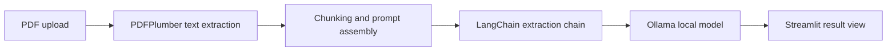

# Local Document AI Extraction

Local-first PDF extraction proof of concept using Ollama, LangChain, PDFPlumber, Streamlit, and Docker.

> Portfolio demo only. Use synthetic/sample documents. Do not commit uploaded documents, PHI, PII, employer-confidential material, client files, or proprietary data.

## Problem

Many document AI workflows need to extract structured facts from PDFs without sending sensitive files to an external API. This project demonstrates a local extraction pattern: parse PDF text, chunk it, prompt a locally served LLM, and return targeted extraction results through a lightweight UI.

## Architecture



## What It Demonstrates

- Local/private LLM workflow with Ollama.
- PDF text extraction with PDFPlumber.
- Chunk-based processing for larger documents.
- Prompt-driven structured extraction criteria.
- Streamlit UI for quick analyst workflows.
- Docker Compose runtime for local model serving.

## Quick Start

### Offline extraction regression checks (no model or dependencies)

The included `extraction_eval.py` checks saved structured outputs against reference fields. It is useful when changing a document-extraction prompt or local model: detect missing fields, wrong values, invalid JSON, and invented extra fields before accepting a change.

```bash
git clone https://github.com/smgpulse007/ollama_poc.git
cd ollama_poc
python extraction_eval.py --cases examples/eval/cases.jsonl --predictions examples/eval/predictions-pass.jsonl
python -m unittest discover -s tests -v
```

Requires only Python 3.10+. The hand-written passing fixture has 2 cases and 8 matching fields, exiting 0. The following deliberately incorrect fixture exits 1, reports 7/8 matching fields, and flags an invented field:

```bash
python extraction_eval.py --cases examples/eval/cases.jsonl --predictions examples/eval/predictions-fail.jsonl --report evaluation.json
```

These fixtures demonstrate the evaluator; they are **not model outputs or evidence of extraction accuracy**.

To check your own synthetic examples, create two JSONL files with unique string IDs:

```json
{"id":"demo-1","expected":{"invoice_id":"INV-DEMO-01","due_date":null}}
```

```json
{"id":"demo-1","output":{"invoice_id":"INV-DEMO-01","due_date":null}}
```

`output` can also be a string containing a JSON object. Save one structured output per example from your extraction workflow. The Streamlit UI currently returns free-form chunk responses; this CLI does not run a model, merge those chunks, or infer a schema. Ask for JSON and review the reference values yourself before evaluating.

The comparison uses exact scalar values, positional arrays, and JSON Pointer paths. Missing is distinct from `null`, strings are distinct from numbers, and boolean `true` is distinct from numeric `1`. JSON decimal/exponent values are parsed exactly with `Decimal`, so large values do not round to a false match and small values do not underflow to zero. Numerically equal JSON numbers such as `18` and `18.0` match. Empty containers count as reference leaves. Field accuracy is matched reference leaves divided by total reference leaves; extra fields are reported separately and still fail the case. No fuzzy date, currency, or semantic normalization is applied.

Exit codes: **0** all cases match with no extra fields; **1** an output differs, is absent, or is invalid; **2** reference/input/report errors (including duplicate or unknown IDs). Reports contain case IDs, paths, statuses, and counts, not document text or field values. Use synthetic IDs and field names too if reports will be shared. The new CI workflow exercises only this offline path.

### PDF extraction UI (Ollama required)

```bash
git clone https://github.com/smgpulse007/ollama_poc.git
cd ollama_poc

python -m venv venv
.\venv\Scripts\activate
pip install -r requirements.txt

docker compose up -d
docker compose exec ollama ollama pull gemma3:4b

streamlit run app.py
```

Open `http://localhost:8501`, upload a synthetic/sample PDF, and enter extraction criteria.

The checked-in Compose configuration requests an NVIDIA GPU. The UI defaults to `gemma3:4b`, matching the pull command. Its LangChain dependencies are unpinned, so this legacy UI path requires separate environment validation; passing the offline checks does not establish that the PDF/model stack runs.

## Sample Extraction Prompt

```text
Extract all invoice dates, company names, payment terms, total amounts, and unresolved exception notes. Return concise bullet points grouped by document section.
```

## How It Works

1. Streamlit accepts a local PDF upload.
2. `pdf_processor.py` extracts text and splits it into chunks.
3. LangChain assembles extraction prompts for the selected criteria.
4. `PDFProcessor` calls Ollama through LangChain; `ollama_client.py` is a separate client used by the prompt/memory smoke scripts.
5. The app aggregates chunk-level responses for review.

## Validation

```bash
python test_prompt.py
python test_memory.py
python -m compileall .
```

The full extraction path requires Docker, an Ollama container, and a pulled local model.

## Privacy And Safety

- Uploaded documents are not intended to be committed.
- Use synthetic/sample documents only.
- Local inference reduces external data exposure but does not replace security review.
- Review all extracted outputs before using them in any downstream workflow.

## Limitations

- OCR for scanned PDFs is not implemented in this minimal PoC.
- Extraction quality depends on source PDF text quality and selected local model.
- No production auth, audit trail, retention controls, or human-review workflow is included.
- Not a clinical, legal, financial, or compliance decision system.

## Portfolio Relevance

Demonstrates privacy-preserving document AI architecture, local LLM orchestration, PDF parsing, prompt design, Dockerized runtime setup, and analyst-facing workflow design.

## License

MIT License. See [LICENSE](LICENSE).
