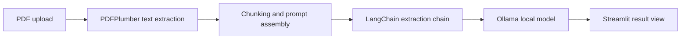

# Local Document AI Extraction

Local-first PDF extraction proof of concept using Ollama, LangChain, PDFPlumber, Streamlit, and Docker.

> Portfolio demo only. Use synthetic/sample documents. Do not commit uploaded documents, PHI, PII, employer-confidential material, client files, or proprietary data.

## Problem

Many document AI workflows need to extract structured facts from PDFs without sending sensitive files to an external API. This project demonstrates a local extraction pattern: parse PDF text, chunk it, prompt a locally served LLM, and return targeted extraction results through a lightweight UI.

## Architecture



## What It Demonstrates

- Local/private LLM workflow with Ollama.
- PDF text extraction with PDFPlumber.
- Chunk-based processing for larger documents.
- Prompt-driven structured extraction criteria.
- Streamlit UI for quick analyst workflows.
- Docker Compose runtime for local model serving.

## Quick Start

```bash
git clone https://github.com/smgpulse007/ollama_poc.git
cd ollama_poc

python -m venv venv
.\venv\Scripts\activate
pip install -r requirements.txt

docker compose up -d
docker exec -it ollama ollama pull gemma3:4b

streamlit run app.py
```

Open `http://localhost:8501`, upload a synthetic/sample PDF, and enter extraction criteria.

## Sample Extraction Prompt

```text
Extract all invoice dates, company names, payment terms, total amounts, and unresolved exception notes. Return concise bullet points grouped by document section.
```

## How It Works

1. Streamlit accepts a local PDF upload.
2. `pdf_processor.py` extracts text and splits it into chunks.
3. LangChain assembles extraction prompts for the selected criteria.
4. `ollama_client.py` calls a local Ollama model endpoint.
5. The app aggregates chunk-level responses for review.

## Validation

```bash
python test_prompt.py
python test_memory.py
python -m compileall .
```

The full extraction path requires Docker, an Ollama container, and a pulled local model.

## Privacy And Safety

- Uploaded documents are not intended to be committed.
- Use synthetic/sample documents only.
- Local inference reduces external data exposure but does not replace security review.
- Review all extracted outputs before using them in any downstream workflow.

## Limitations

- OCR for scanned PDFs is not implemented in this minimal PoC.
- Extraction quality depends on source PDF text quality and selected local model.
- No production auth, audit trail, retention controls, or human-review workflow is included.
- Not a clinical, legal, financial, or compliance decision system.

## Portfolio Relevance

Demonstrates privacy-preserving document AI architecture, local LLM orchestration, PDF parsing, prompt design, Dockerized runtime setup, and analyst-facing workflow design.

## License

MIT License. See [LICENSE](LICENSE).
